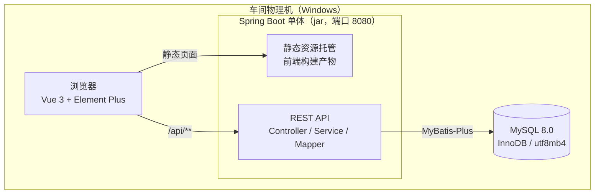
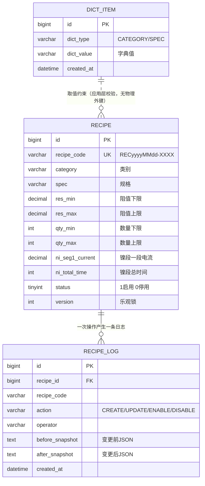
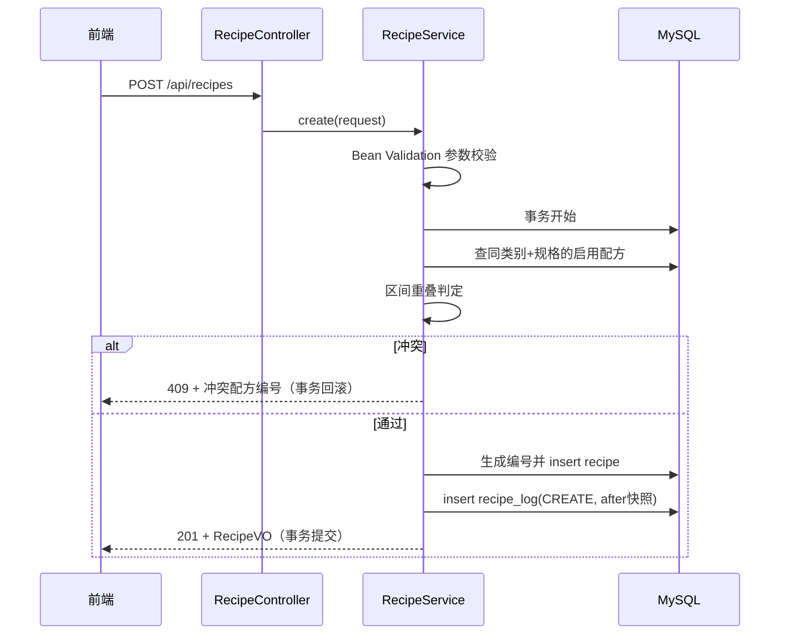

# 本地资料库（电镀配方库）概要设计文档

创建日期：2026-10-21
上游文档：[本地资料库-PRD.md](../prd/本地资料库-PRD.md)

## 1. 设计概述

本设计覆盖配方库模块：配方增删改查（软删除）、范围重叠校验、操作日志、类别/规格字典管理、扫码匹配查询能力的后端接口与前端页面实现方案。不包含登录鉴权、扫码上料与批次管理（后续模块）。

需求追溯：

| PRD 功能 | 对应接口 | 涉及数据表 |
|---|---|---|
| F1 配方列表 | I1 分页查询、I8 字典列表 | recipe |
| F2 新增配方 | I3 新增 | recipe、recipe_log |
| F3 修改配方 | I2 详情、I4 修改 | recipe、recipe_log |
| F4 停用/启用 | I5 状态切换 | recipe、recipe_log |
| F5 操作日志 | I7 日志查询 | recipe_log |
| F6 匹配查询 | I6 匹配 | recipe |
| F7 字典管理 | I8–I10 字典接口 | dict_item |

设计约束 `[Data-backed]`（用户确认）：Windows 物理机单机部署；前端 Vue 3 + Element Plus；后端 JDK 8 + Spring Boot 2.7.x；数据持久化用 MySQL；本期无登录鉴权。

术语：镍段/锡段指电镀工艺先后两段工序；段电流/段时间分三个阶梯；"重叠"特指 PRD 规则 R1 定义的阻值与数量双区间交叉。

## 2. 总体架构与技术选型



上图是单机单进程结构：浏览器访问同一个 8080 端口，静态页面与接口都由 Spring Boot 进程提供，应用数据全部落在本机 MySQL。不引入网关、缓存与消息队列，因为单机低并发场景下这些组件只会增加运维负担 `[Expert judgment]`。

选型与理由：

| 选项 | 决定 | 理由 |
|---|---|---|
| 后端框架 | Spring Boot 2.7.18 + JDK 8 | 用户指定运行环境 `[Data-backed]`；2.7.x 为该 JDK 下最后稳定大版本 |
| ORM | MyBatis-Plus | 单表 CRUD 样板代码最少，国内生态成熟，团队接手成本低 `[Expert judgment]` |
| 数据库 | MySQL 8.0，InnoDB，utf8mb4 | 用户要求持久化 `[Data-backed]`；InnoDB 事务保证"重叠校验 + 写入"的原子性 |
| 前端 | Vue 3 + Vite + Element Plus + Pinia + Axios | 用户指定 `[Data-backed]`；表单/表格场景与 Element Plus 组件库契合 |
| 前端部署形态 | 构建产物由 Spring Boot 静态托管 | 车间机器只需维护一个 Java 进程，无 Nginx 等额外组件 `[Expert judgment]` |

## 3. 数据库设计



配方主表只存"当前值"，历史数值全部由日志表的快照承载：任意历史时点的参数都能从日志重建，满足 PRD 规则 R5 与后续批次追溯，避免本期就引入版本表的两表同步复杂度 `[Expert judgment]`。类别/规格由字典表统一维护，配方表只存值、不建物理外键，取值合法性与删除保护由服务端校验 `[Expert judgment]`。

建表语句（首次启动自动执行，幂等）：

```sql
CREATE DATABASE IF NOT EXISTS `electroplate` DEFAULT CHARACTER SET utf8mb4;

CREATE TABLE IF NOT EXISTS `recipe` (
  `id`                 BIGINT        NOT NULL AUTO_INCREMENT COMMENT '主键',
  `recipe_code`        VARCHAR(32)   NOT NULL COMMENT '配方编号 RECyyyyMMdd-XXXX',
  `category`           VARCHAR(32)   NOT NULL COMMENT '类别，如 RC/AS/HP',
  `spec`               VARCHAR(32)   NOT NULL COMMENT '规格，如 0603/1210',
  `res_min`            DECIMAL(12,4) NOT NULL COMMENT '阻值下限(Ω)',
  `res_max`            DECIMAL(12,4) NOT NULL COMMENT '阻值上限(Ω)',
  `qty_min`            INT           NOT NULL COMMENT '数量下限(pcs)',
  `qty_max`            INT           NOT NULL COMMENT '数量上限(pcs)',
  `ni_seg1_current`    DECIMAL(8,2)  NOT NULL DEFAULT 0 COMMENT '镍段一段电流(A)',
  `ni_seg1_time`       INT           NOT NULL DEFAULT 0 COMMENT '镍段一段时间(Sec)',
  `ni_seg2_current`    DECIMAL(8,2)  NOT NULL DEFAULT 0,
  `ni_seg2_time`       INT           NOT NULL DEFAULT 0,
  `ni_seg3_current`    DECIMAL(8,2)  NOT NULL DEFAULT 0,
  `ni_seg3_time`       INT           NOT NULL DEFAULT 0,
  `ni_total_time`      INT           NOT NULL COMMENT '镍段总时间(Sec)',
  `ni_protect_current` DECIMAL(8,2)  NOT NULL COMMENT '镍段保护电流(A)',
  `ni_alarm_voltage`   DECIMAL(8,2)  NOT NULL COMMENT '镍段报警电压(V)',
  `sn_seg1_current`    DECIMAL(8,2)  NOT NULL DEFAULT 0 COMMENT '锡段一段电流(A)',
  `sn_seg1_time`       INT           NOT NULL DEFAULT 0,
  `sn_seg2_current`    DECIMAL(8,2)  NOT NULL DEFAULT 0,
  `sn_seg2_time`       INT           NOT NULL DEFAULT 0,
  `sn_seg3_current`    DECIMAL(8,2)  NOT NULL DEFAULT 0,
  `sn_seg3_time`       INT           NOT NULL DEFAULT 0,
  `sn_total_time`      INT           NOT NULL COMMENT '锡段总时间(Sec)',
  `sn_protect_current` DECIMAL(8,2)  NOT NULL COMMENT '锡段保护电流(A)',
  `sn_alarm_voltage`   DECIMAL(8,2)  NOT NULL COMMENT '锡段报警电压(V)',
  `status`             TINYINT       NOT NULL DEFAULT 1 COMMENT '1启用 0停用',
  `version`            INT           NOT NULL DEFAULT 0 COMMENT '乐观锁版本号',
  `created_by`         VARCHAR(32)   DEFAULT NULL COMMENT '创建人',
  `created_at`         DATETIME      NOT NULL COMMENT '创建时间',
  `updated_by`         VARCHAR(32)   DEFAULT NULL COMMENT '修改人',
  `updated_at`         DATETIME      NOT NULL COMMENT '修改时间',
  PRIMARY KEY (`id`),
  UNIQUE KEY `uk_recipe_code` (`recipe_code`),
  KEY `idx_cat_spec_status` (`category`, `spec`, `status`)
) ENGINE = InnoDB DEFAULT CHARSET = utf8mb4 COMMENT = '电镀配方';

CREATE TABLE IF NOT EXISTS `recipe_log` (
  `id`              BIGINT       NOT NULL AUTO_INCREMENT COMMENT '主键',
  `recipe_id`       BIGINT       NOT NULL COMMENT '配方ID',
  `recipe_code`     VARCHAR(32)  NOT NULL COMMENT '配方编号',
  `action`          VARCHAR(16)  NOT NULL COMMENT 'CREATE/UPDATE/ENABLE/DISABLE',
  `operator`        VARCHAR(32)  DEFAULT NULL COMMENT '操作人',
  `before_snapshot` TEXT         DEFAULT NULL COMMENT '变更前完整JSON快照',
  `after_snapshot`  TEXT         DEFAULT NULL COMMENT '变更后完整JSON快照',
  `created_at`      DATETIME     NOT NULL COMMENT '操作时间',
  PRIMARY KEY (`id`),
  KEY `idx_recipe_id` (`recipe_id`),
  KEY `idx_created_at` (`created_at`)
) ENGINE = InnoDB DEFAULT CHARSET = utf8mb4 COMMENT = '配方操作日志';

CREATE TABLE IF NOT EXISTS `dict_item` (
  `id`         BIGINT      NOT NULL AUTO_INCREMENT COMMENT '主键',
  `dict_type`  VARCHAR(16) NOT NULL COMMENT '字典类型 CATEGORY/SPEC',
  `dict_value` VARCHAR(32) NOT NULL COMMENT '字典值',
  `created_at` DATETIME    NOT NULL COMMENT '创建时间',
  PRIMARY KEY (`id`),
  UNIQUE KEY `uk_type_value` (`dict_type`, `dict_value`)
) ENGINE = InnoDB DEFAULT CHARSET = utf8mb4 COMMENT = '字典（类别/规格）';

-- 初始字典预置（幂等插入，可按现场实际调整）
INSERT IGNORE INTO `dict_item` (`dict_type`, `dict_value`, `created_at`) VALUES
('CATEGORY', 'RC', NOW()), ('CATEGORY', 'AS', NOW()), ('CATEGORY', 'HP', NOW()),
('SPEC', '0402', NOW()), ('SPEC', '0603', NOW()), ('SPEC', '1210', NOW()),
('SPEC', '2010', NOW()), ('SPEC', '2512', NOW());
```

索引与一致性说明：

- `idx_cat_spec_status` 服务两个高频路径：重叠校验（按类别 + 规格取启用配方）与匹配查询（类别 + 规格 + 启用 + 区间条件），均为前缀命中 `[Expert judgment]`。
- 快照列用 TEXT 存 JSON 字符串而非 JSON 类型，规避 TypeHandler 配置成本，查询侧由后端反序列化 `[Expert judgment]`。
- 删除字典项前先按 category/spec 精确统计 recipe 引用（命中 idx_cat_spec_status 前缀），被引用返回 40903 拒绝删除 `[Expert judgment]`。
- 重叠校验与写入在同一事务内完成；并发编辑用 `version` 乐观锁拦截（UPDATE ... WHERE version = ?），单机少人场景足够 `[Expert judgment]`。
- 数据量预估：配方数千条以内、日志每日新增数十条 `[Hypothesis]`，无需分区与归档策略。

## 4. 接口设计

统一响应包：`{ "code": 0, "message": "success", "data": ... }`，code 为业务码，HTTP 状态码同步语义化。

错误码：

| code | HTTP | 含义 |
|---|---|---|
| 0 | 200 / 201 | 成功 |
| 40000 | 400 | 参数校验失败，message 指明具体字段 |
| 40401 | 404 | 配方不存在 |
| 40901 | 409 | 范围重叠冲突，data 返回冲突配方编号 |
| 40902 | 409 | 数据已被他人修改（乐观锁失败） |
| 40903 | 409 | 字典项已被配方引用，不可删除 |
| 50000 | 500 | 服务器内部错误 |

接口清单：

| # | 方法 | 路径 | 说明 |
|---|---|---|---|
| I1 | GET | /api/recipes | 分页查询配方 |
| I2 | GET | /api/recipes/{id} | 配方详情 |
| I3 | POST | /api/recipes | 新增配方 |
| I4 | PUT | /api/recipes/{id} | 修改配方 |
| I5 | PUT | /api/recipes/{id}/status | 停用/启用 |
| I6 | GET | /api/recipes/match | 匹配查询（供扫码上料调用） |
| I7 | GET | /api/recipe-logs | 操作日志查询 |
| I8 | GET | /api/dicts?type= | 字典列表（类别/规格） |
| I9 | POST | /api/dicts | 新增字典项 |
| I10 | DELETE | /api/dicts/{id} | 删除字典项 |

### I1 分页查询配方

| 项 | 内容 |
|---|---|
| 参数 | category（字典值精确，可选）、spec（字典值精确，可选）、resistance（数值，可选，按 res_min ≤ v ≤ res_max 过滤）、qty（整数，可选，同理）、status（ENABLED/DISABLED/ALL，默认 ENABLED）、page（默认 1）、size（默认 20，最大 100） |
| 响应 | `{ total: 123, records: [RecipeVO] }`，按 updated_at 倒序 |
| 错误码 | 40000 |

### I3 新增配方 / I4 修改配方

请求体（I4 额外携带 version）：

```json
{
  "category": "RC", "spec": "0603",
  "resMin": 0.001, "resMax": 0.01, "qtyMin": 1000, "qtyMax": 5000,
  "nickel": { "seg1Current": 1.5, "seg1Time": 30, "seg2Current": 2.0, "seg2Time": 60,
              "seg3Current": 0, "seg3Time": 0, "protectCurrent": 0.5, "alarmVoltage": 3.0 },
  "tin":    { "seg1Current": 1.0, "seg1Time": 20, "seg2Current": 1.5, "seg2Time": 40,
              "seg3Current": 0, "seg3Time": 0, "protectCurrent": 0.4, "alarmVoltage": 2.5 }
}
```

| 项 | 内容 |
|---|---|
| 校验 | 必填与数值规则同 PRD 第 5 节，服务端 Bean Validation 全量执行；类别/规格须存在于字典；总时间不由前端提交，服务端按三段之和计算；随后执行重叠校验（排除自身 id） |
| 响应 | I3 返回 201 + RecipeVO（含生成的配方编号）；I4 返回 200 + RecipeVO |
| 错误码 | 40000、40401（I4）、40901、40902（I4） |

RecipeVO 字段：id、recipeCode、category、spec、resMin、resMax、qtyMin、qtyMax、nickel{9 项}、tin{9 项}、status（字符串 ENABLED/DISABLED）、version、createdBy、createdAt、updatedBy、updatedAt。

### I5 停用/启用

| 项 | 内容 |
|---|---|
| 请求体 | `{ "status": "ENABLED" | "DISABLED" }` |
| 处理 | 启用时重新执行重叠校验；状态切换写一条日志（含变更前快照） |
| 响应 | 200 + RecipeVO |
| 错误码 | 40000、40401、40901（仅启用方向） |

### I6 匹配查询

| 项 | 内容 |
|---|---|
| 参数 | category、spec、resistance（数值）、qty（整数），全部必填 |
| 处理 | 仅在启用配方中查找闭区间命中者；由 R1 规则保证至多一条 |
| 响应 | 命中返回 200 + RecipeVO；未命中返回 200 + data=null + message"无匹配配方"；出现多条命中（理论不可能）返回 50000 并记录告警日志，作为防御分支 |

### I7 操作日志查询

| 项 | 内容 |
|---|---|
| 参数 | recipeCode（精确）、action、operator（模糊）、startTime、endTime（yyyy-MM-dd HH:mm:ss）、page、size |
| 响应 | `{ total, records: [{ id, recipeId, recipeCode, action, operator, createdAt, before, after }] }`，before/after 为反序列化后的配方对象或 null，按 createdAt 倒序 |

### I8–I10 字典管理

- I8：`GET /api/dicts?type=CATEGORY|SPEC`，响应 `[{ id, value }]`，按创建时间正序，供配方表单与列表筛选下拉使用。
- I9：`POST /api/dicts`，请求体 `{ "type": "CATEGORY", "value": "RC" }`；同组内重复返回 40000；成功 201。
- I10：`DELETE /api/dicts/{id}`；字典项被任何配方引用（含停用）时返回 40903，message 含引用数量；成功 204。

## 5. 后端模块与关键算法

包结构：

```
backend/src/main/java/com/electroplate/
├── controller/    RecipeController、RecipeLogController、DictController
├── service/       RecipeService（校验+编号生成+日志写入）、RecipeLogService、DictService
├── mapper/        RecipeMapper、RecipeLogMapper、DictItemMapper（MyBatis-Plus）
├── entity/        Recipe、RecipeLog、DictItem
├── dto/           RecipeSaveRequest、RecipeQuery、RecipeVO、LogQuery、LogVO
├── common/        ApiResponse、ErrorCode、GlobalExceptionHandler
└── config/        MybatisPlusConfig、WebConfig
```

重叠校验算法（对应 PRD 规则 R1）：

```
findConflict(category, spec, new, excludeId):
    for old in 启用配方 where category=category and spec=spec and id != excludeId:
        resOverlap = new.resMin <= old.resMax and old.resMin <= new.resMax
        qtyOverlap = new.qtyMin <= old.qtyMax and old.qtyMin <= new.qtyMax
        if resOverlap and qtyOverlap:
            return old.recipeCode        # 冲突，直接返回给前端提示
    return null                            # 无冲突
```

保存流程时序：



时序图中的关键点：参数校验在事务外快速失败；重叠判定与两次写入在同一事务内，要么全部生效要么全部回滚。修改流程（I4）与此一致，仅多一步乐观锁判断（UPDATE 影响行数为 0 时返回 40902）。

配方编号生成：事务内取当日最大流水 +1，格式 REC + yyyyMMdd + 4 位流水；`uk_recipe_code` 唯一键兜底，冲突时自动重试（上限 3 次）`[Expert judgment]`。

## 6. 前端结构

```
frontend/
├── src/
│   ├── api/          request.js（axios 实例，统一拦截 code!=0 弹错）、recipe.js、log.js、dict.js
│   ├── views/        RecipeList.vue（列表+筛选+分页）、OperationLog.vue、DictManagement.vue
│   ├── components/   RecipeFormDialog.vue（新增/编辑共用表单弹窗）
│   ├── router/       / → /recipes 重定向；/recipes；/logs；/dicts
│   ├── stores/      Pinia（字典缓存等轻状态）
│   └── utils/        校验规则（区间下限≤上限、数值≥0）
```

要点：表单弹窗对镍段/锡段两组参数用同一子组件渲染，减少重复；重叠冲突的 40901 响应在弹窗内以醒目文案回显冲突编号；类别/规格下拉数据来自字典接口，进入页面时拉取并缓存；总时间随三段时间实时联动显示且只读。

## 7. 部署方案

仓库布局：

```
Electroplate-controller/
├── prd/          需求文档
├── design/       设计文档
├── backend/      Spring Boot 工程
└── frontend/     Vue 3 工程
```

构建与发布（在开发机执行）：

1. `frontend` 执行 `npm run build`，产物 dist 拷贝至 `backend/src/main/resources/static`（提供一键打包脚本完成拷贝 + mvn package）。
2. 产出单个 `electroplate-backend.jar`，拷贝到车间机器。

车间物理机（Windows）环境与运行：

1. 安装 JDK 8、MySQL 8.0；创建数据库（建表语句由应用首次启动自动执行，`CREATE TABLE IF NOT EXISTS` 幂等）。
2. `application.yml` 配置数据源（本机 MySQL、强密码）、端口 8080、时区 Asia/Shanghai。
3. 用 WinSW 将 `java -jar` 注册为 Windows 服务，开机自启、崩溃自动拉起 `[Expert judgment]`。
4. 车间内浏览器访问 `http://<机器IP>:8080`。

数据备份：Windows 任务计划每日定时 `mysqldump electroplate`，保留近 30 天备份文件到本机备份目录 `[Expert judgment]`。

## 8. 非功能设计

- 性能：单机并发 ≤ 5、配方量数千条 `[Hypothesis]`；列表与匹配查询走 `idx_cat_spec_status` 索引，毫秒级返回，无需缓存。
- 可用性：单进程 + Windows 服务自动拉起；MySQL 数据目录与备份目录分盘存放 `[Expert judgment]`。
- 日志：logback 输出至 `logs/` 目录按天滚动，保留 30 天；业务操作以 recipe_log 表为准。
- 时间：全链路统一 Asia/Shanghai 时区，避免 JNI/数据库时区偏移。
- 安全：仅车间内网访问，本期无鉴权 `[Data-backed]`；MySQL root 限本机登录；8080 端口不对公网暴露。
