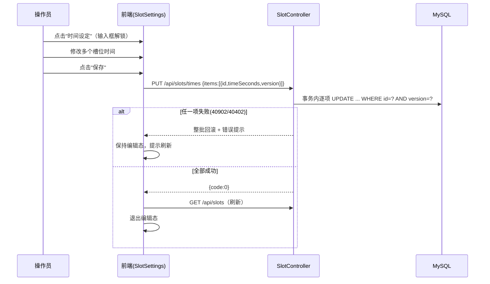

# 生产参数设置 概要设计

创建日期：2026-10-21
上游文档：[生产参数设置-PRD.md](../prd/生产参数设置-PRD.md)

## 1. 总体架构

沿用本地资料库模块架构，不引入新组件：

* 后端：Spring Boot 2.7（JDK 8）+ MyBatis-Plus + MySQL 8.0，统一响应包 `{code, message, data}`，业务异常经 `BusinessException` + `GlobalExceptionHandler` 转换。

* 前端：Vue 3 + Element Plus，hash 路由，`/api` 经 Axios 调用。

* 部署：前后端同 jar 单进程 8080 端口，`schema.sql` 幂等追加新表。

## 2. 数据库设计

新增 `slot` 表（追加至 schema.sql 末尾，幂等）：

```sql
CREATE TABLE IF NOT EXISTS `slot` (
  `id`           BIGINT       NOT NULL AUTO_INCREMENT COMMENT '主键',
  `slot_name`    VARCHAR(32)  NOT NULL COMMENT '槽位名称，如 酸洗/镀镍1/交换',
  `slot_type`    TINYINT      NOT NULL DEFAULT 0 COMMENT '槽位类型：0 普通槽 / 1 镀槽',
  `time_seconds` INT          NOT NULL DEFAULT 0 COMMENT '时间设定值(秒)，所有槽位均需设定',
  `show_time`    TINYINT      NOT NULL DEFAULT 1 COMMENT '是否展示时间：0 隐藏 / 1 展示',
  `switch_on`    TINYINT      NOT NULL DEFAULT 1 COMMENT '开关状态：0 关 / 1 开（仅镀槽有效）',
  `sort_no`      INT          NOT NULL DEFAULT 1 COMMENT '工序序号，列表按此升序',
  `status`       TINYINT      NOT NULL DEFAULT 1 COMMENT '状态：0 停用 / 1 启用',
  `version`      INT          NOT NULL DEFAULT 0 COMMENT '乐观锁版本号',
  `created_at`   DATETIME     NOT NULL COMMENT '创建时间',
  `updated_at`   DATETIME     NOT NULL COMMENT '修改时间',
  PRIMARY KEY (`id`),
  UNIQUE KEY `uk_slot_name` (`slot_name`),
  UNIQUE KEY `uk_sort_no` (`sort_no`)
) ENGINE=InnoDB DEFAULT CHARSET=utf8mb4 COMMENT='产线槽位配置';
```

说明：

* 名称全局唯一（含停用槽位），对应 PRD R1；以唯一键兜底并发新增。

* 无操作日志表（本期不记录，PRD R6）。

* 槽位数量少（产线约 30 个以内），列表接口不分页，全量返回。

## 3. 接口契约

错误码在现有基础上扩展：

| 错误码   | HTTP | 含义           |
| ----- | ---- | ------------ |
| 40402 | 404  | 槽位不存在        |
| 40904 | 409  | 槽位名称已存在      |
| 40905 | 409  | 工序序号已被其他槽位占用 |

沿用：0 成功、40000 参数错误、40902 乐观锁冲突、50000 内部错误。

### J1 槽位列表

`GET /api/slots?status=ENABLED|DISABLED|ALL`（默认 ENABLED）

按 `sort_no ASC, id ASC` 排序，全量返回（不分页）。

```json
{ "code": 0, "message": "success", "data": [ { "id": 1, "slotName": "酸洗", "slotType": 0,
  "timeSeconds": 30, "showTime": true, "switchOn": false, "sortNo": 1,
  "status": "ENABLED", "version": 0, "createdAt": "2026-10-21 09:00:00", "updatedAt": "..." } ] }
```

### J2 新增槽位

`POST /api/slots`，成功 201，返回 SlotVO。

```json
{ "slotName": "镀镍3", "slotType": 1, "timeSeconds": 120, "showTime": true, "switchOn": true, "sortNo": 8 }
```

校验：名称非空 ≤32；类型 0/1；时间 ≥0 整数；序号 ≥1；名称唯一（40904）；序号唯一含停用（40905）。新增默认启用、version=0。

### J3 修改槽位配置

`PUT /api/slots/{id}`，body 同 J2 另加 `version`（必填，乐观锁）。成功返回 SlotVO；版本冲突 40902。

### J4 删除槽位

`DELETE /api/slots/{id}`，成功返回 204。物理删除，名称与工序序号即释放；不存在时 40402。

### J5 批量保存时间

`PUT /api/slots/times`（时间设定模式的"保存"按钮）

```json
{ "items": [ { "id": 1, "timeSeconds": 45, "version": 3 }, { "id": 4, "timeSeconds": 0, "version": 1 } ] }
```

* 单事务逐项更新（`time_seconds` + `version+1` + `updated_at`）；

* 任一项版本冲突（40902）或不存在（40402）→ 整批回滚，message 指明冲突槽位名；

* 仅校验 timeSeconds ≥0；不改其他字段；

* 成功返回 `{code:0}`，前端重新拉取 J1。

### J6 开关即时切换

`PUT /api/slots/{id}/switch`，body `{ "switchOn": true }`

仅镀槽允许（普通槽 40000）；后发覆盖（不带乐观锁，开关为高频快速操作）；返回 SlotVO。

## 4. 后端设计

新增文件（包结构与配方模块一致）：

```
entity/Slot.java               @Version 乐观锁
mapper/SlotMapper.java
dto/SlotVO.java                slotType/showTime/switchOn/status 序列化为语义化值
dto/SlotSaveRequest.java       J2/J3 请求体（javax.validation 注解）
dto/SlotQuery.java             status
dto/SlotTimeBatchRequest.java  J5 请求体（嵌套 Item: id/timeSeconds/version）
dto/SwitchRequest.java         J6 请求体
service/SlotService.java       业务逻辑
controller/SlotController.java J1~J6
```

SlotService 关键逻辑：

- list：按 status 过滤（解析规则与配方一致：ENABLED/DISABLED/ALL，非法值 40000；本期删除为物理删除，数据均为启用，参数保留兼容）。
- create/update：名称查重、序号查重（全表）→ 唯一键兜底；update 走 MyBatis-Plus 乐观锁，影响行数 0 → 40902。
- delete：物理删除 deleteById。

* updateTimes：`@Transactional`，循环逐项带 version 更新，任一失败抛异常整批回滚。

* switchOn：校验 slotType=1，直接 updateById（不走乐观锁）。

schema.sql 追加 slot 建表语句（幂等）。

## 5. 前端设计

### 5.1 路由与菜单

* 新路由 `/slots`（槽位管理）、`/production`（生产参数设置），均懒加载。

* 左侧菜单新增两个大模块，与"本地资料库"并列：**槽位管理**（图标 Grid）、**生产参数设置**（图标 Operation）。两个页面均为单页，模块内无 Tab。

* 菜单顺序：本地资料库、生产参数设置、槽位管理。

### 5.2 页面与组件

```
views/SlotManage.vue          槽位管理页（表格 + 增删改 + 停用/启用）
views/ProductionSettings.vue  生产参数设置页（卡片流 + 时间设定模式 + 开关）
components/SlotFormDialog.vue 新增/编辑槽位弹窗（槽位管理页使用）
api/slot.js                   J1~J6 封装
```

SlotManage.vue 结构：

- 工具栏："新增槽位"按钮。
- 表格列：槽位名称、类型（普通槽/镀槽 el-tag）、时间设定值(Sec)、是否展示时间、工序序号、修改时间、操作（编辑 / 删除）。
- 删除：confirm 二次确认（不可恢复、名称与序号释放）后调 J4，刷新列表。

ProductionSettings.vue 结构：

* 工具栏："时间设定"模式按钮；编辑态下显示"保存""取消"。

* 卡片流（el-row/el-col 响应式，每行 4 个，仅启用槽位）：每张卡片显示 序号+名称+类型标签、时间输入框（showTime=是才显示；浏览态只读，编辑态可写）、开关（仅镀槽，即时调 J6，失败回滚 UI）。

* 时间设定模式：进入编辑态时记录基线快照；保存时 diff 出被修改项（携带 version）调 J5；取消恢复基线。编辑态下切换路由/关闭提示确认。

SlotFormDialog.vue：字段见 PRD 4.2；编辑回填带 version；镀槽类型时显示开关开关项；保存失败保持弹窗打开（沿用配方弹窗交互约定）。

## 6. 关键时序：时间批量保存



## 7. 部署

与现有模块一致：`build-all.bat` 一键打包；schema.sql 幂等追加，已有环境重启 jar 即自动建表，无需手工操作。
