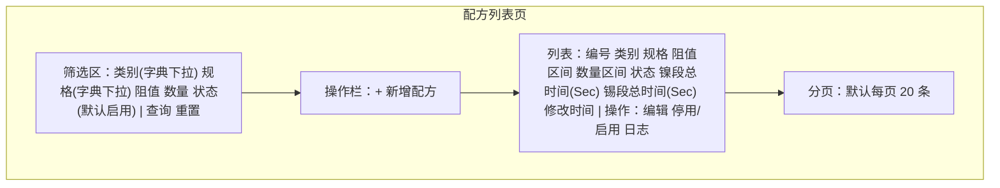
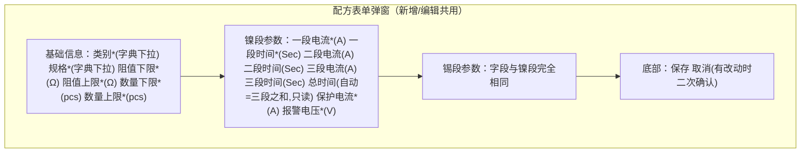

# 本地资料库（电镀配方库）产品需求文档

创建日期：2026-10-21
上游需求：[本地资料库.md](本地资料库.md)

## 1. 背景与目标

电镀产线在扫码上料时，需要按产品的类别、规格、阻值、数量找到对应的电镀工艺参数（镍段、锡段的电流/时间/电压）。这些对应关系此前依赖纸面或 Excel 维护，查找慢、改动无记录、参数变更后无法追溯当时用了哪一版数值。

本地资料库是电镀控制系统的第一个模块，把"产品条件 → 工艺参数"的对应关系集中管理，为后续扫码上料模块提供自动匹配的数据来源。

本期目标：

1. 工艺员可以在界面上录入、修改、停用/启用配方，操作全程留痕。
2. 同一类别 + 规格下，启用配方的阻值区间与数量区间互不交叉，保证任意一次扫码匹配结果唯一。
3. 任何一次参数修改都能回查修改前的数值，为后续生产批次追溯打基础。

## 2. 用户与场景

| 角色 | 使用方式 | 频率 | 说明 |
|---|---|---|---|
| 工艺员 | 新增、修改、停用/启用配方，查日志 | 每天 | 熟悉电镀参数含义；本期系统无登录 |
| 操作员 | 按条件查询配方 | 每班多次 | 只看不改 |

本期不做登录与账号（已确认）。创建人/修改人字段本期留空，日志中的操作人同样留空，待账号体系上线后自动补录。

核心场景（按优先级）：

- S1 工艺员新增一条配方并保存成功
- S2 操作员按类别/规格/阻值/数量查到目标配方
- S3 工艺员修改配方参数，系统记录变更前后数值
- S4 工艺员停用旧配方、之后重新启用
- S5 查看某配方的历史变更记录

## 3. 功能总览

| # | 模块 | 功能描述 |
|---|---|---|
| F1 | 配方列表 | 顶部筛选：类别（字典下拉）、规格（字典下拉）、阻值（输入具体值，命中区间即返回）、数量（同前）、状态（默认"启用"，可切换全部/停用）。分页展示，行内提供编辑、停用/启用、日志入口。 |
| F2 | 新增配方 | 弹窗表单分三组：基础信息（类别/规格字典下拉 + 阻值区间/数量区间）、镍段参数、锡段参数。保存时后端做必填、字典合法性、数值与范围重叠校验；重叠时提示冲突配方编号。保存成功后系统生成唯一配方编号。 |
| F3 | 修改配方 | 与 F2 同一表单回填；保存时重新校验重叠；自动更新修改时间（修改人本期留空，待账号体系补录）；修改前数值以快照写入操作日志。配方编号与创建信息不可改。 |
| F4 | 停用/启用 | 二次确认后切换状态。停用配方不参与扫码匹配；重新启用时重新做重叠校验（可能与其他启用配方冲突，冲突则启用失败）。 |
| F5 | 操作日志 | 按配方编号、动作（新增/修改/启用/停用）、时间范围查询；点开记录可看变更前后参数对比。 |
| F6 | 匹配查询能力 | 供后续扫码上料模块调用：输入类别 + 规格 + 阻值 + 数量，返回唯一命中的启用配方；无命中时返回明确提示。 |
| F7 | 字典管理 | 维护类别与规格两类字典：新增、删除字典项。配方表单与列表筛选的类别/规格下拉数据来自字典；同组内字典值不可重复；被配方引用（含停用配方）的字典项不可删除。 |

## 4. 页面与交互

### 4.1 配方列表页

- 业务逻辑：输入阻值 0.05 查询时，返回所有阻值下限 ≤ 0.05 ≤ 阻值上限的配方；数量同理。类别/规格为字典值精确筛选。
- 交互逻辑：编辑 → 打开表单弹窗；停用 → 确认框提示"停用后不参与扫码匹配，可随时重新启用"；启用 → 确认后校验，冲突则报错并停留在列表页。
- 空状态：暂无配方时展示"暂无配方，点击右上角新增录入"。

### 4.2 新增/编辑弹窗

- 前端先做必填与数值校验（见第 5 节），通过后才提交；服务端校验为准。
- 类别/规格只能从字典下拉选择；字典为空时提示"请先在字典管理中维护"并禁止提交。
- 总时间为只读自动计算项，恒等于三段时间之和：前端随段时间实时联动显示，服务端保存时重新计算，不接受手工输入。
- 范围重叠冲突时提示"与配方 REC-xxxx 的阻值/数量区间重叠"，表单不关闭，方便调整数值。
- 编辑弹窗顶部只读展示配方编号与创建时间。

### 4.3 操作日志

入口有两个：列表行内"日志"按钮（自动带入该配方条件）；顶部导航"操作日志"页（全量条件查询）。列表列：时间、配方编号、动作，点开行查看变更前后参数对比（左右两栏，差异字段高亮）。操作人列待账号体系上线后展示。

### 4.4 字典管理页

类别、规格两组列表（页签切换），每组展示字典值列表 + 新增输入框 + 删除按钮。新增时校验同组不重复；删除时若被任意配方（含停用）引用则拒绝并提示"已被 N 条配方引用"。

## 5. 字段与校验规则

基础信息：

| 字段 | 类型 | 必填 | 规则 |
|---|---|---|---|
| 类别 | 字典下拉 | 是 | 取自类别字典（初始预置示例：RC、AS、HP） |
| 规格 | 字典下拉 | 是 | 取自规格字典（初始预置示例：0402、0603、1210、2010、2512） |
| 阻值下限/上限 | 数值，最多 4 位小数（Ω） | 是 | ≥ 0；下限 ≤ 上限 |
| 数量下限/上限 | 整数（pcs） | 是 | ≥ 0；下限 ≤ 上限 |

工艺参数（镍段、锡段各一组，规则相同）：

| 字段 | 类型 | 必填 | 规则 |
|---|---|---|---|
| 一段电流 / 一段时间 | 数值 2 位小数（A）/ 整数（Sec） | 是 | ≥ 0 |
| 二段、三段电流/时间 | 同上 | 否 | 留空或 0 表示该段不使用 |
| 总时间 | 整数（Sec） | 自动 | 只读，恒等于三段时间之和，服务端计算 |
| 保护电流 | 数值 2 位小数（A） | 是 | ≥ 0 |
| 报警电压 | 数值 2 位小数（V） | 是 | ≥ 0 |

## 6. 业务规则

R1 范围重叠判定（核心规则）：同一类别 + 规格下，设两条启用配方 A、B：

- 阻值重叠 = A.阻值下限 ≤ B.阻值上限 且 B.阻值下限 ≤ A.阻值上限
- 数量重叠 = A.数量下限 ≤ B.数量上限 且 B.数量下限 ≤ A.数量上限
- 两者同时成立 → 冲突，禁止保存或启用

区间为闭区间，边界相等视为重叠。该规则保证任意一组（阻值, 数量）输入至多命中一条启用配方，匹配结果唯一。

R2 数值合法性：所有电流/时间/电压 ≥ 0；每个区间下限 ≤ 上限。
R3 软删除：停用只改状态，不物理删除；停用配方不参与匹配；可重新启用，启用时按 R1 重新校验。
R4 编号唯一：配方编号由系统自动生成，格式 REC + 日期 + 4 位流水（如 REC20261021-0001），创建后不变。
R5 留痕：新增、修改、停用、启用各产生一条日志；修改/停用/启用记录变更前完整快照，任意历史时点的参数可回查。
R6 权限说明：本期无登录，界面不做角色区分；建议通过车间电脑的管理手段控制写操作权限 `[Assumption — 待确认]`。
R7 字典约束：类别/规格只能从字典选择；同组内字典值不可重复；被配方引用（含停用配方）的字典项不可删除。

## 7. 边界与异常

| 场景 | 系统行为 |
|---|---|
| 保存时与已有启用配方重叠 | 保存失败，提示冲突配方编号，表单不关闭 |
| 启用时发生重叠 | 启用失败，提示冲突配方编号 |
| 匹配查询无结果 | 返回明确的"无匹配配方"提示 |
| 列表无数据 | 展示空状态引导文案 |
| 两人同时修改同一条配方 | 后提交者提示"数据已被他人修改，请刷新后重试"（乐观锁） |
| 绕过前端直连接口提交非法数据 | 服务端全量校验，前端校验仅为辅助 |
| 类别/规格字典为空 | 表单提示"请先在字典管理中维护"，禁止提交 |
| 删除被引用的字典项 | 删除失败，提示该字典项已被 N 条配方引用 |

## 8. 本期范围与验收标准

本期包含 F1–F7。本期不包含：登录与角色权限、扫码上料与批次管理、配方物理删除、数据批量导入导出。

验收标准：

1. 新增一条完整配方成功入库，编号自动生成且全局唯一。
2. 在同一类别 + 规格下构造阻值与数量均交叉的第二条配方，保存被拒绝并提示冲突编号。
3. 修改配方后，操作日志可查到变更前后两组完整数值。
4. 停用后的配方不出现在匹配结果中；重新启用成功。
5. 匹配能力对给定输入返回唯一启用配方；无命中返回明确提示。
6. 服务重启后数据仍在（数据持久化）。
7. 类别/规格字典可新增与删除；同组重复值被拒绝；被配方引用的字典项删除被拒绝。
