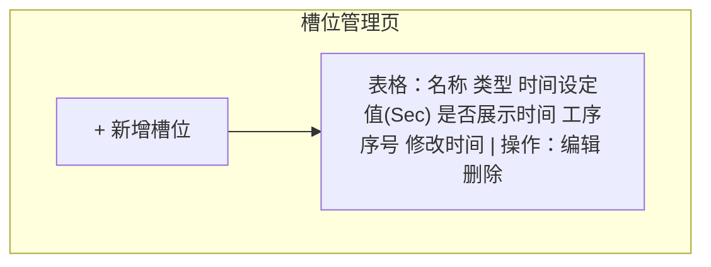
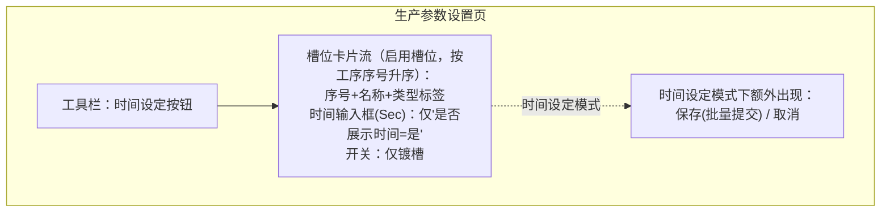

# 生产参数设置 产品需求文档

创建日期：2026-10-21
上游需求：[生产参数设置.md](生产参数设置.md)

## 1. 背景与目标

产线由一串按工序顺序排列的槽位组成（酸洗、水洗、镀镍 1~10、镀锡 1~10、交换、预浸等）。系统需要两个层面：

- **槽位管理**（配置层）：工艺员维护产线有哪些槽位及其基础属性（名称、类型、工序序号、默认时间、是否展示时间等）。
- **生产参数设置**（操作层）：操作员在生产参数设置页面对各槽位设定工艺时间、切换镀槽开关。

本期目标：

1. 槽位基础信息可维护：新增、修改、停用（删除即停用）、重新启用。
2. 生产参数设置页按工序顺序动态展示启用槽位：镀槽显示开关，"是否展示时间"为是的槽位显示时间输入框。
3. 时间修改采用"时间设定 → 统一保存"的两段式操作，避免误触；开关切换即时生效。

已确认的决策：

- 工序顺序用**序号输入**维护，列表按序号升序。
- 时间修改需先点击"时间设定"按钮解锁编辑，页面提供统一"保存"按钮批量提交。
- 槽位管理与生产参数设置为**两个独立菜单**。
- 本期**不记录**槽位操作日志。
- 无登录账号，创建人/修改人留空（与本地资料库模块一致）。

## 2. 用户与场景

| 角色 | 使用方式 | 频率 | 说明 |
|---|---|---|---|
| 工艺员 | 槽位管理：新增/修改/停用/启用槽位 | 槽位调整时 | 本期系统无登录 |
| 操作员 | 生产参数设置：设定各槽位时间、切换镀槽开关 | 每班 | 仅操作时间与开关 |

核心场景（按优先级）：

- S1 工艺员新增槽位（如新增"镀镍 3"），配置类型、时间、序号后保存
- S2 操作员打开生产参数设置页，按工序顺序看到所有启用槽位的时间与开关
- S3 操作员点击"时间设定"，修改若干槽位时间后统一保存
- S4 操作员切换某镀槽开关，立即生效
- S5 工艺员删除某槽位（如设备检修下线），该槽位从生产参数设置页消失；重新上线时重新新增（名称与序号随删除释放）

## 3. 功能总览

| # | 模块 | 功能描述 |
|---|---|---|
| F1 | 槽位管理列表 | 独立菜单"槽位管理"。表格列出槽位：名称、类型（普通槽/镀槽标签）、时间设定值、是否展示时间、工序序号、修改时间；操作列：编辑、删除。 |
| F2 | 新增/编辑槽位 | 弹窗表单：槽位名称、槽位类型、时间设定值（秒）、是否展示时间、工序序号、开关初始状态（仅镀槽）。编辑带乐观锁。 |
| F3 | 删除槽位 | 物理删除，二次确认后执行，不可恢复；删除后名称与工序序号即释放，可被新槽位复用。 |
| F4 | 生产参数设置页 | 独立菜单"生产参数设置"。按工序序号升序展示**启用**槽位卡片：镀槽显示开关按钮（点击即生效）；"是否展示时间"为是的槽位显示时间输入框，为否的不显示输入框。本页不提供任何槽位配置的编辑入口。 |
| F5 | 时间设定模式 | 生产参数设置页默认浏览态（输入框只读）。点击"时间设定"进入编辑态：输入框解锁，出现"保存"与"取消"。保存批量提交全部时间修改；取消还原。 |

## 4. 页面与交互

### 4.1 槽位管理页

### 4.2 新增/编辑槽位弹窗

| 字段 | 控件 | 必填 | 说明 |
|---|---|---|---|
| 槽位名称 | 文本输入 | 是 | ≤32 字符，全局唯一（含停用槽位） |
| 槽位类型 | 单选 | 是 | 0 普通槽 / 1 镀槽 |
| 时间设定值(Sec) | 数字输入 | 是 | ≥0 整数；所有槽位（含不展示时间的）均需设定 |
| 是否展示时间 | 开关 | 是 | 默认开；关=生产参数设置页不显示该槽位时间输入框 |
| 工序序号 | 数字输入 | 是 | ≥1 整数，全局唯一；两个页面均按此升序 |
| 开关状态 | 开关 | 镀槽显示 | 仅槽位类型=镀槽时出现，默认开 |

### 4.3 生产参数设置页

时间设定模式交互：

1. 浏览态：时间输入框只读。
2. 点击"时间设定"：进入编辑态（按钮高亮），所有展示时间的槽位输入框解锁；出现"保存""取消"。
3. 保存：一次性提交全部被修改槽位的时间（每项携带版本号，服务端事务内逐项乐观锁更新，任一版本冲突整批失败并提示刷新）。
4. 取消：丢弃本地修改，恢复只读。
5. 保存成功后自动退出编辑态并刷新数据。

## 5. 业务规则

| # | 规则 |
|---|---|
| R1 | 槽位名称全局唯一；删除槽位后名称即释放。 |
| R2 | 工序序号全局唯一，为 ≥1 的整数。排序：sort_no 升序；删除槽位后序号即释放。 |
| R3 | 时间设定值为 ≥0 的整数（秒）。所有槽位都必须有值；"不展示时间"只影响生产参数设置页是否显示输入框，不影响数据本身。 |
| R4 | 开关状态仅对镀槽有意义；普通槽不展示开关，字段值忽略。 |
| R5 | 删除为物理删除，二次确认后执行；槽位从生产参数设置页消失，名称与工序序号释放。 |
| R6 | 本期不记录槽位操作日志（已确认，后续需要再扩展）。 |
| R7 | 时间批量保存为事务操作：任一项版本冲突（40902）或槽位不存在（40402）则整批回滚。 |

## 6. 数据要求

槽位配置持久化于 MySQL（`slot` 表，见概要设计），字段覆盖 4.2 全部配置项，另含状态、乐观锁版本、创建/修改时间。

## 7. 验收标准

1. 槽位管理页新增槽位、编辑、删除均正常，列表按工序序号排列。
2. 生产参数设置页：镀槽显示开关、普通槽不显示开关；切换开关立即生效并有成功提示。
3. "是否展示时间"为否的槽位，生产参数设置页不出现时间输入框。
4. 未点击"时间设定"时，所有时间输入框只读；点击后可编辑；保存后数值生效；点击取消后恢复原值。
5. 删除槽位需二次确认；删除后从两页消失，其名称与工序序号可立即被新槽位使用。
6. 新增/编辑时名称或工序序号重复被拒绝并提示。
7. 服务重启后全部槽位配置、时间值与开关状态不丢失。
